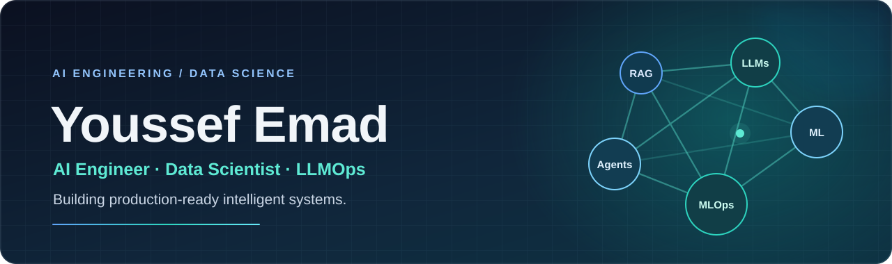

<!-- GitHub profile README · YoussefEmad04 -->

  

  
<strong>Building reliable AI systems — from machine learning experiments to production APIs, RAG, and agent workflows.</strong>

  

    
    
    
  

  

---

### 👋 About me

I'm **Youssef Emad**, an **AI Engineer and Data Scientist** based in Cairo, Egypt. I work on applied machine learning, LLM-powered products, data pipelines, and the engineering needed to turn an AI prototype into a usable system.

- 💼 **Data Scientist** at **Smart Vision Technology**
- 🎓 **M.Sc. in Informatics** student at **Nile University** · B.Sc. in Artificial Intelligence
- 🧑‍🏫 **AI/ML & LLMOps Instructor** at **Route Academy**
- 🏆 **Kaggle Master** — Notebooks
- 🎯 **Interests:** LLMOps, RAG evaluation, knowledge graphs, agent orchestration, applied data science, and production ML

### 🧩 What I work on

| AI systems | Production engineering | Data & analytics |
| :--- | :--- | :--- |
| RAG & knowledge graphs | FastAPI model serving | ML classification & risk scoring |
| LLM evaluation & fine-tuning | Docker & AWS deployment | SQL, ETL & medallion pipelines |
| LangGraph agent workflows | Monitoring & reproducibility | Analytics & BI dashboards |

### 🛠️ Tech stack

  
<strong>Machine learning · Backend · Cloud · Data</strong>

  
  

    
    
    
    
    
    
  

---

### 🚀 Featured projects

<table>
<tr>
<td width="50%" valign="top">
  <h3>🎓 <a href="https://github.com/YoussefEmad04/Graduation_Project">UniMate — Smart Academic Advisor</a></h3>
  
A student-facing AI assistant combining <strong>RAG</strong>, a <strong>Neo4j knowledge graph</strong>, and <strong>LangGraph</strong> routing to answer academic-policy and course-prerequisite questions.

  
<code>FastAPI</code> <code>LangGraph</code> <code>Neo4j</code> <code>Supabase</code>

  
<a href="https://github.com/YoussefEmad04/Graduation_Project"><strong>Explore project →</strong></a>

</td>
<td width="50%" valign="top">
  <h3>📊 <a href="https://github.com/YoussefEmad04/AI-Powered-Procurement-Risk-Analytics-System">Spend & Risk Copilot</a></h3>
  
Procurement risk analytics with invoice/vendor pipelines, <strong>ML-based risk scoring</strong>, a medallion architecture, dashboards, and natural-language analytics.

  
<code>IBM watsonx</code> <code>Presto</code> <code>Iceberg</code> <code>SQL</code>

  
<a href="https://github.com/YoussefEmad04/AI-Powered-Procurement-Risk-Analytics-System"><strong>Explore project →</strong></a>

</td>
</tr>
<tr>
<td width="50%" valign="top">
  <h3>☁️ <a href="https://github.com/YoussefEmad04/MLOps-Maestro-Enterprise-ML-Deployment-Suite">MLOps Maestro</a></h3>
  
An end-to-end collection of ML deployment workflows, from model serving through <strong>REST APIs</strong> and <strong>Docker</strong> to AWS deployment patterns.

  
<code>FastAPI</code> <code>Docker</code> <code>AWS EC2/ECR/ECS</code>

  
<a href="https://github.com/YoussefEmad04/MLOps-Maestro-Enterprise-ML-Deployment-Suite"><strong>Explore project →</strong></a>

</td>
<td width="50%" valign="top">
  <h3>🧠 <a href="https://github.com/YoussefEmad04/Agentic-Code-Reviewer">Agentic Code Reviewer</a></h3>
  
An LLM-powered <strong>LangGraph</strong> code-review workflow that gives structured feedback on code quality, security, and maintainability through a Flask interface.

  
<code>LangChain</code> <code>LangGraph</code> <code>Flask</code>

  
<a href="https://github.com/YoussefEmad04/Agentic-Code-Reviewer"><strong>Explore project →</strong></a>

</td>
</tr>
</table>

**More projects:** [AI Resume Screening & RAG](https://github.com/YoussefEmad04/CV-Scanning-System) · [License Plate Detection + OCR](https://github.com/YoussefEmad04/CarPlate) · [SQL Data Warehouse](https://github.com/YoussefEmad04/SQL-DWH-Project)

---

### 📈 GitHub activity

  
  

Stats are generated by a third-party service and reflect public GitHub activity; language charts do not measure proficiency.

---

  <h3>🤝 Let's build useful AI together</h3>
  
Interested in production AI, data science, LLM systems, or collaborating on an interesting idea?

  <a href="mailto:emady5579@gmail.com">Email me</a> ·
  <a href="https://www.linkedin.com/in/youssef-emad-742583252/">LinkedIn</a> ·
  <a href="https://www.kaggle.com/youssefemad004">Kaggle</a>

