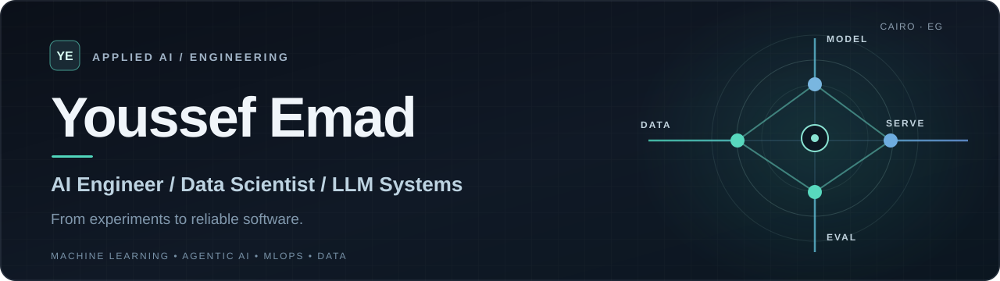
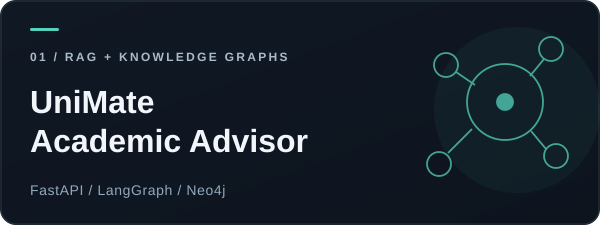
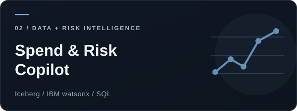
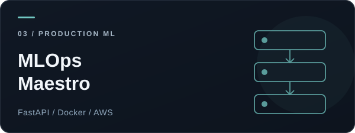
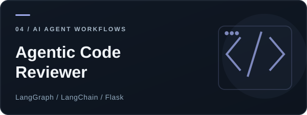

<!-- Youssef Emad · GitHub profile · Editorial portfolio edition -->

  

  

    
    
    
  

## About

I’m an **AI Engineer & Data Scientist** based in Cairo, Egypt. I build applied machine learning systems, LLM-powered applications, and the infrastructure around them — from data preparation and evaluation to APIs, deployment, and monitoring.

**Currently** · Data Scientist at **Smart Vision Technology** · AI/ML & LLMOps Instructor at **Route Academy** · **M.Sc. Informatics** at Nile University.

> I care about the engineering after the demo: measurable quality, clear architecture, and systems people can actually use.

## Selected work

<table>
  <tr>
    <td width="50%" valign="top">
      
      
<strong>RAG + structured knowledge</strong> 
      An academic advisor using retrieval, a Neo4j knowledge graph, and LangGraph routing for policy Q&amp;A and prerequisite reasoning. 
      <strong>Evaluation:</strong> 84% full-match across 150 live prompts, with no runtime failures in the reported test.

      
<a href="https://github.com/YoussefEmad04/Graduation_Project"><strong>Explore repository ↗</strong></a>

    </td>
    <td width="50%" valign="top">
      
      
<strong>Data pipelines + AI analytics</strong> 
      A procurement intelligence platform with invoice and vendor data pipelines, ML risk scoring, medallion layers, and natural-language-to-SQL analytics. 
      IBM watsonx.data · Presto · Iceberg · SQL

      
<a href="https://github.com/YoussefEmad04/AI-Powered-Procurement-Risk-Analytics-System"><strong>Explore repository ↗</strong></a>

    </td>
  </tr>
  <tr>
    <td width="50%" valign="top">
      
      
<strong>Production-oriented ML</strong> 
      End-to-end model deployment workflows spanning REST API serving, containerization, and AWS cloud deployment patterns. 
      FastAPI · Docker · AWS EC2 / ECR / ECS

      
<a href="https://github.com/YoussefEmad04/MLOps-Maestro-Enterprise-ML-Deployment-Suite"><strong>Explore repository ↗</strong></a>

    </td>
    <td width="50%" valign="top">
      
      
<strong>LLM agents + developer tools</strong> 
      A LangGraph code-analysis workflow that returns structured security, maintainability, and style feedback through a Flask UI. 
      LangGraph · LangChain · Flask

      
<a href="https://github.com/YoussefEmad04/Agentic-Code-Reviewer"><strong>Explore repository ↗</strong></a>

    </td>
  </tr>
</table>

**Also worth exploring** · [AI Resume Screening & RAG](https://github.com/YoussefEmad04/CV-Scanning-System) · [License Plate Detection + OCR](https://github.com/YoussefEmad04/CarPlate) · [SQL Data Warehouse](https://github.com/YoussefEmad04/SQL-DWH-Project)

## Engineering focus

| Build intelligent systems | Make them reliable | Work with data |
| :--- | :--- | :--- |
| RAG · knowledge graphs · LLM agents | Evaluation · FastAPI · containerization | SQL · ETL · analytics |
| NLP · fine-tuning · ML models | Deployment · monitoring · cloud | Data pipelines · risk scoring · BI |

**My workflow:** Frame the problem → Build a baseline → Evaluate honestly → Deploy thoughtfully → Observe and improve.

## Tools I work with

  

 

**Machine Learning & AI** · scikit-learn, Pandas, Hugging Face, LangGraph, LangChain, RAG, Neo4j

**Data & Cloud** · SQL, IBM watsonx, Iceberg, Presto, Power BI, AWS

**Application Engineering** · FastAPI, REST APIs, Docker, Git, Linux

## Beyond the code

- **Graduate studies** — M.Sc. Informatics, Nile University.
- **Teaching & mentoring** — Production AI Engineering, ML, and LLMOps concepts at Route Academy.
- **Kaggle Master** — Notebooks category, with a focus on reproducible learning and knowledge sharing.

  
<strong>GitHub activity &amp; language breakdown</strong> — expand

   
  

    
    
  

  These third-party cards represent GitHub activity, not a skills assessment; availability depends on their hosting service.

---

  <h3>Let's build something useful.</h3>
  
Interested in applied AI, production ML, data systems, or LLM engineering?

  

    <a href="mailto:emady5579@gmail.com"><strong>Email</strong></a> &nbsp;·&nbsp;
    <a href="https://www.linkedin.com/in/youssef-emad-742583252/"><strong>LinkedIn</strong></a> &nbsp;·&nbsp;
    <a href="https://www.kaggle.com/youssefemad004"><strong>Kaggle</strong></a>
  

